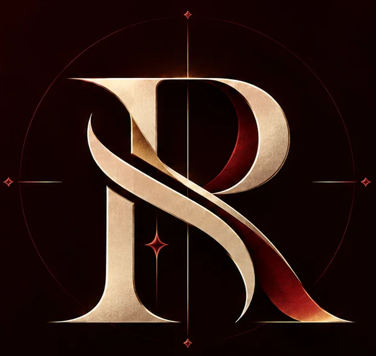
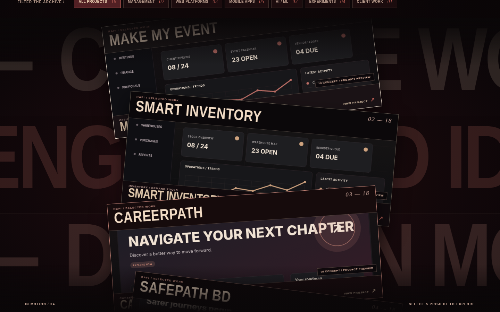
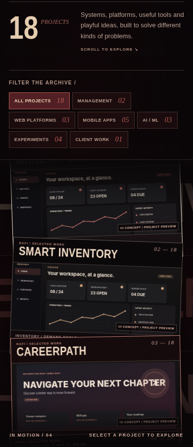
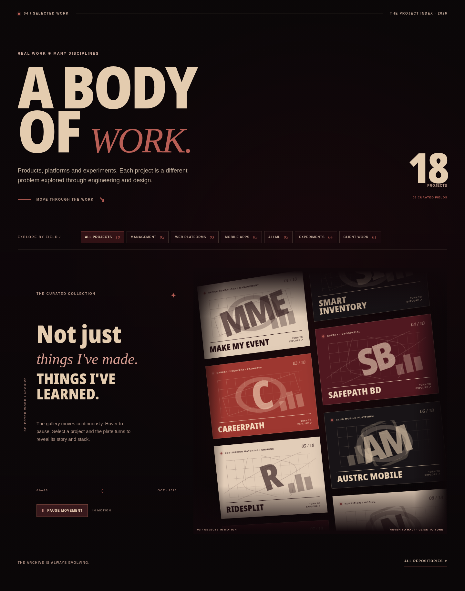
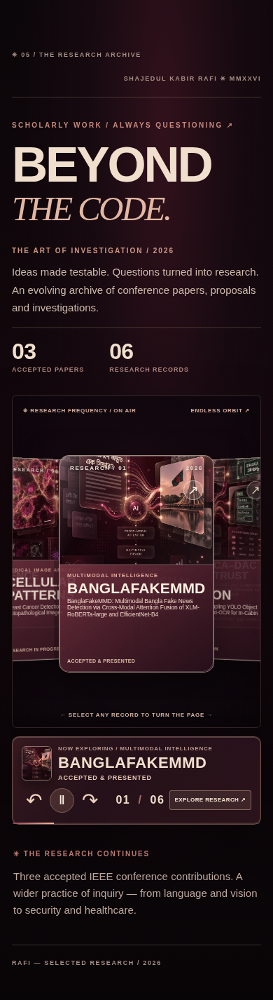

<div align="center">
  <a href="https://shajedulkabir.me" aria-label="Visit Shajedul Kabir Rafi's portfolio">
    
  </a>

  <h1>SHAJEDUL KABIR RAFI</h1>

  <p><strong>Software Engineer · Full-Stack Developer · Product Builder</strong></p>
  <p><em>Ideas made real. Engineering with intention.</em></p>

  <p>
    <a href="https://shajedulkabir.me"><strong>Explore the live portfolio ↗</strong></a>
    &nbsp;·&nbsp;
    <a href="https://github.com/Rafi12234">GitHub</a>
    &nbsp;·&nbsp;
    <a href="https://www.linkedin.com/in/shajedul-kabir-rafi-4489122b2">LinkedIn</a>
    &nbsp;·&nbsp;
    <a href="mailto:shajidulkabir12345@gmail.com">Email</a>
  </p>

  <p>
    
    
    
    
    
  </p>
</div>

---

## About the project

This is my personal portfolio—an editorial, motion-led space for the software I build, the questions I research, and the teams and products I contribute to.

Instead of a conventional grid of cards, the site unfolds like a digital publication: oversized typography, deep burgundy and warm ivory tones, layered visual compositions, and interactive chapters. Beneath the visual design is a **statically generated Astro website**, with targeted animation code and optimized image delivery.

**[Visit shajedulkabir.me →](https://shajedulkabir.me)**

## Inside the experience

| Chapter | What you'll find |
| --- | --- |
| **Introduction** | Cinematic hero, layered portrait, typographic identity, CV download, and portfolio navigation. |
| **Beyond the Title** | A more personal look at engineering principles, curiosity, and growth. |
| **Engineering Universe** | An interactive, animated presentation of technical interests and capabilities. |
| **Selected Work** | **18 projects** spanning web platforms, mobile apps, AI/ML, experiments, management tools, and client work. |
| **Beyond the Code** | **6 research records** presented in a continuously moving, interactive carousel, with individual status and detail views. |
| **Work in Progress** | **3 professional and leadership chapters**—DataPulse Global, Boraq, and AUST Robotics Club. |
| **Recognition** | **3 featured achievements**, with supporting photography and evidence views. |
| **Client Work** | A featured independent streetwear web experience, **Sicko Soul**. |
| **Contact** | Ways to connect, collaborate, and explore more work. |

> This is one continuous scrolling experience; sections are not separate application routes.

## Selected highlights

- **Editorial art direction** — custom visual hierarchy, layered type, cinematic transitions, and a distinctive burgundy/ivory palette.
- **Purposeful interactivity** — a moving project showcase, research-card flip interactions, switchable experience stories, and media lightboxes.
- **Responsive layouts** — layouts and interactions designed for desktop, laptop, tablet, and mobile viewports.
- **Motion with user controls** — GSAP and ScrollTrigger coordinate visual sequences; interactive galleries have pause and navigation controls, and the site considers reduced-motion preferences.
- **Optimized media delivery** — Cloudinary hosts the active website imagery with automatic format/quality transformations and responsive image widths.
- **Static deployment** — pre-rendered Astro output, with no application server or database required for the portfolio itself.

## Preview

The live website is the most up-to-date visual reference. The repository also contains development captures:

| Desktop | Mobile |
| :---: | :---: |
|  |  |

<details>
<summary><strong>More section previews</strong></summary>

<br />

**Selected Work**



**Research — mobile**



</details>

*These checked-in preview images are development snapshots and may differ from the latest live layout, content, and typography.*

## Built with

| Layer | Technology |
| --- | --- |
| Site framework | **Astro 5** (static output) |
| Application code | **TypeScript**, JavaScript |
| Layout and styling | **CSS**, Astro components |
| Motion and scroll effects | **GSAP**, **ScrollTrigger**, **Lenis** |
| Image delivery | **Cloudinary** (`f_auto`, `q_auto`, responsive widths) |
| Typography | **Big Shoulders Display**, **Instrument Sans**, **Instrument Serif** |
| Deployment | **Vercel** |

The portfolio presents projects built with many other technologies, but those stacks belong to their **individual repositories**, not to this site's runtime.

## Run locally

**Requirements:** Node.js 20.19+ or 22.12+ and npm.

```bash
# 1. Clone the repository
git clone https://github.com/Rafi12234/Portfolio---Shajedul-Kabir-Rafi.git
cd Portfolio---Shajedul-Kabir-Rafi

# 2. Install dependencies
npm ci

# 3. Start the development server
npm run dev
```

Open **http://localhost:4321**.

For a production build:

```bash
npm run build
npm run preview
```

Astro generates the deployable static site in **`dist/`**.

Additional repository checks are available as `npm run check:source` and `npm run check:motion`. These are source-level checks, not substitutes for testing the rendered website on real devices.

## Project structure

```text
.
├── src/
│   ├── pages/
│   │   └── index.astro          # Single-page composition
│   ├── components/              # Portfolio sections (Astro)
│   ├── data/                    # Projects, research, experience, awards, contact
│   ├── scripts/                 # Section interactions and motion
│   ├── styles/                  # Shared motion styles
│   └── utils/
│       └── cloudinaryImages.ts  # Public CDN URL and srcset helpers
├── public/
│   ├── styles/                  # Section-specific and responsive CSS
│   └── assets/                  # Source/backup imagery and downloadable CV
├── preview/                     # Development screenshots and previews
├── docs/                        # Design, implementation, and QA notes
├── scripts/                     # Repository tooling and checks
├── tests/                       # Additional test and smoke-check scripts
├── astro.config.mjs             # Static Astro configuration
└── package.json
```

### Updating content

Most portfolio content is intentionally separated from presentation code:

- `src/data/selectedProjects.ts` — project records and categories
- `src/data/research.ts` — research records, statuses, and source links
- `src/data/experience.ts` — organizations, roles, and contributions
- `src/data/achievements.ts` — awards, evidence, and descriptions
- `src/data/clientProjects.ts` — featured client work
- `src/data/contact.ts` — contact details and social links

Edit the relevant data file to change content; edit its matching component or stylesheet to change presentation.

## Media and Cloudinary

The active site serves portfolio artwork through **Cloudinary**. Public delivery URLs and image sizing helpers live in `src/utils/cloudinaryImages.ts`; other static delivery URLs appear in section data, markup, or styles. The original local images remain under `public/assets/` as backups.

No Cloudinary API secret is required to run this frontend. **Never commit API keys or secrets** into a public client-side repository.

> **Visual accuracy:** Project cover illustrations and concept artwork are presentation visuals, not necessarily screenshots of shipped applications. Project capabilities, live status, and implementation details should be checked in the linked project repositories. Research records also distinguish accepted work from submissions, proposals, and ongoing studies.

## Deploying on Vercel

This repository is built for a static deployment:

| Setting | Value |
| --- | --- |
| Framework preset | `Astro` |
| Build command | `npm run build` |
| Output directory | `dist` |
| Install command | `npm ci` |

Connect the GitHub repository to Vercel and select the `main` branch for production. If automatic deployments are enabled, pushes to that branch trigger new deployments. The portfolio itself needs no server-side database or API keys.

## Accessibility and performance notes

This project includes semantic HTML, a skip link, focus states, selected keyboard interactions, reduced-motion handling, responsive image delivery, and visibility-aware animation management. Complex motion can still have different performance characteristics on different devices, so **test mobile touch scrolling, keyboard navigation, contrast, and reduced-motion behavior** after substantial design changes.

## Get in touch

I'm interested in thoughtful software, practical engineering, research, and ambitious digital products.

- **Portfolio:** [shajedulkabir.me](https://shajedulkabir.me)
- **GitHub:** [@Rafi12234](https://github.com/Rafi12234)
- **LinkedIn:** [Shajedul Kabir Rafi](https://www.linkedin.com/in/shajedul-kabir-rafi-4489122b2)
- **Email:** [shajidulkabir12345@gmail.com](mailto:shajidulkabir12345@gmail.com)

---

<div align="center">
  <p><strong>IDEAS MADE REAL.</strong></p>
  <p><sub>Designed and developed by Shajedul Kabir Rafi · Dhaka, Bangladesh</sub></p>
</div>

*No `LICENSE` file is currently included in this repository. Source availability does not automatically grant permission to reuse its code, images, design, or client materials.*